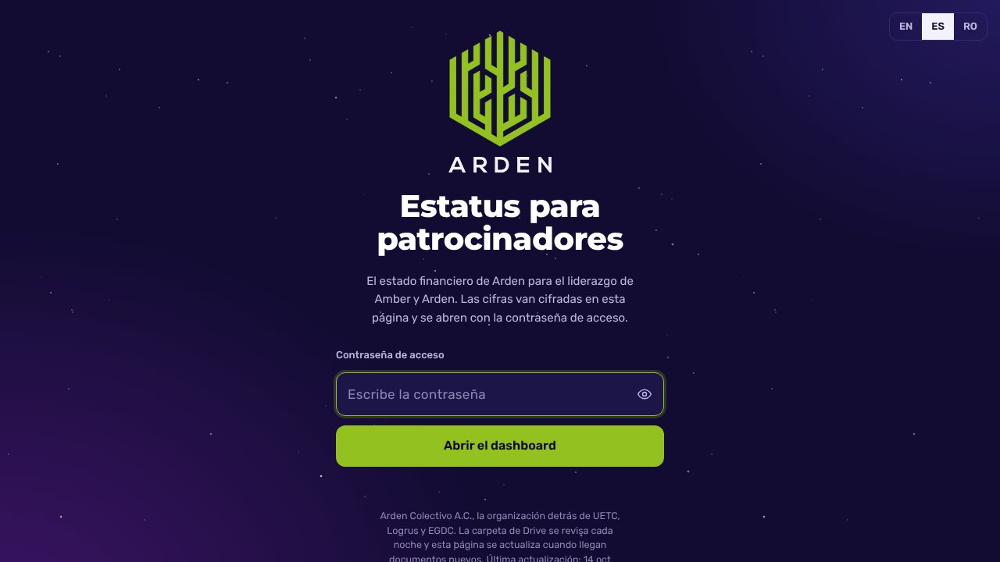
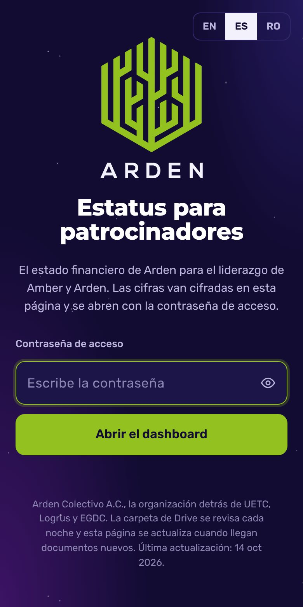

# Arden Status

[English](./README.md) · **Español**

> Página de estatus cifrada para patrocinadores de Arden.

**[▶ Abrir la página](https://status.uetc.mx)** · Arden

## ¿Qué es?

Una página de estatus para patrocinadores de Arden, servida en [status.uetc.mx](https://status.uetc.mx). La dirección anterior, `ardenstatus.jorgesuarez.com.mx`, redirige ahí (comprobado el 10 nov 2026). El contenido va cifrado y solo abre con la contraseña de acceso.

## ¿Para quién es?

Para los patrocinadores que tienen la contraseña. Nadie más puede leerla.

## ¿Qué dolor resuelve?

Compartir el estatus con los patrocinadores sin dejarlo en un chat ni exponerlo en una página pública.

## La propuesta

Una sola página, siempre en la misma dirección, con el contenido cifrado con AES-256-GCM. Sin la contraseña no hay cifras.

## ¿Cómo se usa?

1. Abre [status.uetc.mx](https://status.uetc.mx).
2. Escribe la contraseña.
3. Lee el estatus. La página muestra la fecha de su última actualización.

## ¿Cuándo conviene y cuándo no?

Conviene para consulta de patrocinadores. No es el sitio público de Arden.

## ¿Dónde lo pruebo?

  
  

Captura real de la pantalla de acceso, 10 nov 2026. El contenido cifrado no se muestra.

## Hasta dónde llegamos

En línea. Este repo solo tiene la página; el contenido legible no vive aquí.

## Para quien construye

Un `index.html` estático con el contenido cifrado. Usa la identidad de Arden, no la marca personal de Jorge Suárez.

## Licencia

Este repo no tiene archivo de licencia, así que Arden conserva todos los derechos sobre el código, el contenido y la marca. Si quieres reutilizar algo, pide permiso primero abriendo un issue.

---

Repositorio mantenido por <a href="https://github.com/jorgefsb">Jorge Suárez</a> · <a href="./README.md">Read in English</a> · Documentación actualizada el 10 nov 2026.

