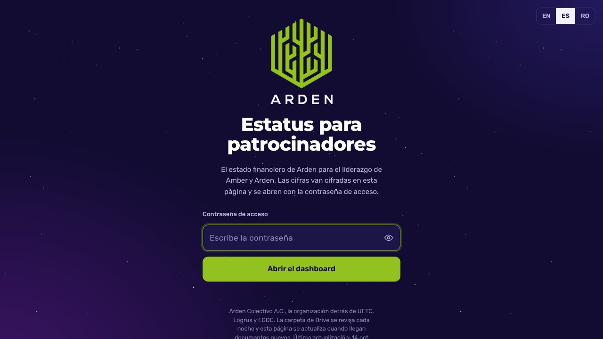
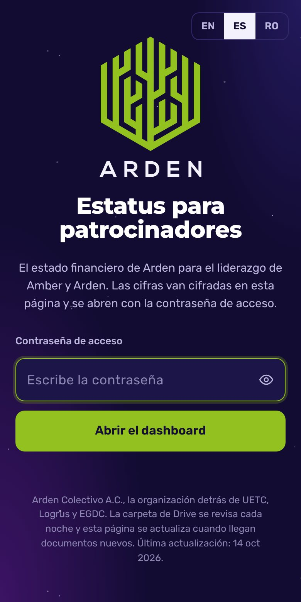

# Arden Status

**English** · [Español](./README.es.md)

> Encrypted status page for Arden sponsors.

**[▶ Open the page](https://ardenstatus.jorgesuarez.com.mx)** · Arden

## What is it?

A status page for Arden sponsors, served at [ardenstatus.jorgesuarez.com.mx](https://ardenstatus.jorgesuarez.com.mx). The content is encrypted and opens only with the access password.

## Who is it for?

For sponsors who have the password. Nobody else can read it.

## What pain does it solve?

Sharing the status with sponsors without leaving it in a chat or exposing it on a public page.

## The proposal

One page, always at the same address, with the content encrypted with AES-256-GCM. Without the password there are no figures.

## How do I use it?

1. Open [ardenstatus.jorgesuarez.com.mx](https://ardenstatus.jorgesuarez.com.mx).
2. Type the password.
3. Read the status. The page shows the date of its last update.

## When it fits and when it doesn't

It fits for sponsor lookups. It is not Arden's public site.

## Where can I try it?

  
  

Real screenshot of the access screen, 10 Nov 2026. The encrypted content is not shown.

## How far we got

Live. This repo only holds the page; the readable content does not live here.

## For builders

A static `index.html` with the encrypted content. It uses Arden's identity, not Jorge Suárez's personal brand.

## License

This repo has no license file, so Arden keeps all rights to the code, the content and the brand. If you want to reuse something, ask first by opening an issue.

---

Repository maintained by <a href="https://github.com/jorgefsb">Jorge Suárez</a> · <a href="./README.es.md">Leer en español</a> · Documentation updated on 10 Nov 2026.

